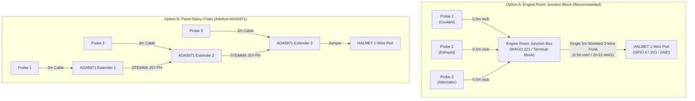

# 1-Wire Marine Engine Temperature Probes: Architecture & Wiring Guide

This document evaluates the design, component selection, marine electrical
topology, and wiring recommendations for installing 1-Wire digital temperature
probes (such as the Dallas/Maxim DS18B20 and high-temperature thermocouple
alternatives) on a marine sailing yacht.

The specific scenario evaluated is monitoring three (3) engine zone
temperatures (e.g. cylinder head/coolant, dry/wet exhaust mixing elbow, and
alternator or engine room ambient) located in the engine compartment, situated
approximately **3 meters (cable distance)** away from the main HALMET gateway.

---

## 1. Marine Operating Environment & Temperature Ranges

Monitoring a marine diesel engine (e.g. Yanmar, Volvo Penta, or Beta Marine)
requires sensors suited to distinct thermal zones:

| Engine Location | Typical Operating Temp | Overheat / Alarm Threshold | Suitable Sensor Technology |
| :--- | :--- | :--- | :--- |
| **Coolant / Thermostat Housing** | $75^\circ\text{C to }88^\circ\text{C}$ | $> 95^\circ\text{C}$ | DS18B20 stainless steel probe |
| **Engine Block / Cylinder Head** | $80^\circ\text{C to }90^\circ\text{C}$ | $> 100^\circ\text{C}$ | DS18B20 bolt-on ring lug |
| **Alternator Frame / Case** | $50^\circ\text{C to }85^\circ\text{C}$ | $> 105^\circ\text{C}$ | DS18B20 ring lug or probe |
| **Engine Compartment Ambient** | $30^\circ\text{C to }50^\circ\text{C}$ | $> 65^\circ\text{C}$ | DS18B20 ambient probe |
| **Wet Exhaust Mixing Elbow (External)** | $35^\circ\text{C to }55^\circ\text{C}$ | $> 65^\circ\text{C}$ | DS18B20 clamped to hose/elbow |
| **Dry Exhaust Gases (Internal EGT)** | $300^\circ\text{C to }600^\circ\text{C}$ | $> 650^\circ\text{C}$ | **Type-K Thermocouple** (MAX31850) |

> [!WARNING] **DS18B20 Temperature Ceiling:** Standard DS18B20 silicon sensors
> have an absolute maximum rating of **$+125^\circ\text{C}$**
> ($257^\circ\text{F}$). They must **never** be inserted into dry exhaust gas
> streams. On wet exhaust systems, clamping a probe to the *outside* of the
> rubber exhaust hose immediately downstream of the raw water injection elbow
> provides an ultra-fast raw water failure alarm (normal: $\approx
> 45^\circ\text{C}$; alarm: $> 65^\circ\text{C}$) while keeping the sensor well
> below $+125^\circ\text{C}$. For direct inside-manifold exhaust gas
> measurement, use a Type-K thermocouple with a 1-Wire MAX31850 converter
> instead.

---

## 2. Sensor Probe Types & Sourcing

### 2.1 Waterproof Stainless Steel Probe (Cylinder / Hose Surface)
* **Description:** Pre-potted DS18B20 inside a $6 \times 50\,\text{mm}$
  waterproof stainless steel tube with PVC or silicone jacketed cable.
* **Mounting:** Clamped directly to rubber hoses using hose clamps, or inserted
  into dry thermowells.
* **EU Availability:** In stock at GoTronic (ref. `03657` / `37380`) and
  Mouser.

### 2.2 Bolt-On Lug Probe (Alternator / Cylinder Head Bolt)
* **Description:** DS18B20 potted inside a tinned copper or brass M6/M8 ring
  lug.
* **Mounting:** Bolted directly onto the alternator casing ground stud or an
  external engine block bolt for immediate thermal conductivity.
* **EU Availability:** Available from Adafruit (Product ID `5883`), Mouser, or
  specialized marine 1-Wire suppliers.

### 2.3 High-Temperature Thermocouple 1-Wire Option (Internal Exhaust)
* **Description:** Type-K stainless steel threaded probe ($0\dots
  800^\circ\text{C}$) paired with a **Maxim MAX31850K** 1-Wire thermocouple
  amplifier.
* **Bus Integration:** The MAX31850 appears on the 1-Wire bus exactly like a
  DS18B20, sharing the same 3-wire bus and ROM addressing.

---

## 3. Wiring Topology Analysis: Terminal Block vs Adafruit ADA5971

The user's setup consists of **three (3) probes in the engine room**, located
**3 meters away** from the HALMET gateway.

Two primary topologies exist:
- **Option A (Engine Room Junction Block):** Star-connecting the 3 probes in
  the engine compartment via a terminal block, running a single 3-wire trunk
  cable 3 meters back to HALMET.
- **Option B (Panel Daisy-Chain via Adafruit ADA5971):** Running 3 individual
  3-meter cables from each probe back to the electrical panel, chaining them
  via Adafruit ADA5971 extender modules.



### 3.1 Evaluating Option A (Engine Room Junction Box + Single Trunk)
* **How It Works:**
  - Place a small IP65 waterproof junction box in the engine room (on a
    bulkhead away from exhaust heat).
  - Join the three sensor leads (Red to Red, Black to Black, Yellow/Blue to
    Yellow/Blue) using **WAGO 221 lever nuts** or a marine terminal barrier
    strip.
  - Run **one high-quality marine 3-conductor shielded cable** 3 meters back to
    HALMET.
* **Electrical Physics (AN-148 Analysis):**
  - Maxim Application Note 148 defines this as a **"Star Cluster at the End of
    a Trunk"**.
  - Because the stubs inside the engine compartment are very short ($<
    0.5\text{ m}$), the reflections damp out within nanoseconds. The 3-meter
    trunk behaves cleanly as a single transmission line back to the master.
* **Marine Maintenance Advantages:**
  - Running a **single ruggedized cable** through engine bulkheads and cable
    glands is far cleaner and more watertight than dragging three fragile
    sensor leads through the boat.
  - If a probe is damaged or fails during an engine overhaul, you replace just
    the short probe inside the engine room junction box without re-pulling 3
    meters of wire through the yacht.

### 3.2 Evaluating Option B (Adafruit ADA5971 Extender Modules)
* **What the ADA5971 Is:**
  - The **Adafruit 5971** is an adapter board featuring screw terminals for one
    DS18B20, dual JST-PH 2.0 mm connectors for chaining, a signal activity LED,
    and an onboard $4.7\,\text{k}\Omega$ pull-up resistor.
* **Why Option B is Sub-Optimal for this Layout:**
  1. **Parallel Pull-Up Resistor Clashing:**
     - HALMET **already has an onboard pull-up resistor** on its 1-Wire pin
       (GPIO 4).
     - Each ADA5971 module includes another $4.7\,\text{k}\Omega$ pull-up.
     - Chaining 3 modules in parallel puts four pull-ups in parallel:
       $$R_{\text{total}} = \frac{4.7\,\text{k}\Omega}{4} \approx
       1.17\,\text{k}\Omega$$
     - This excessively stiff pull-up overloads the weak $4\,\text{mA}$
       open-drain pulldown transistor inside the DS18B20 chips, leading to
       intermittent bit errors unless traces are cut.
  2. **Cable Pulling Burden:**
     - Pulling three individual 3-meter thin PVC sensor cables through engine
       compartment glands clutters the electrical panel.
  3. **Vibration & Environment:**
     - Bare un-potted PCB extenders with friction JST connectors are suited for
       clean indoor electronics, not moist engine environments.

---

## 4. Recommended Engineering Solution

### 4.1 Topology & Cable Specification
**Implement Option A:**
1. **Engine Room Junction:** Install a small IP65 junction box inside the
   engine compartment. Use **WAGO 221-413 or 221-415** spring-lever connectors
   with corrosion protection (WAGO Gelbox or dielectric grease).
2. **Trunk Cable to HALMET (3 meters):**
   - **Wire Gauge:** **$0.34\,\text{mm}^2\text{ to }0.50\,\text{mm}^2$** (**22
     AWG or 20 AWG**).
   - **Cable Type:** **Shielded 3-conductor marine instrumentation cable**
     (e.g. Lapp UNITRONIC, Belden 9533, or marine-grade tinned copper 3x0.5
     $\text{mm}^2$ with drain wire).
   - **Conductor Color Standard:**
     - **Red:** $+3.3\,\text{V}$ (or $+5.0\,\text{V}$)
     - **Black (or Blue):** Ground ($0\,\text{V}$)
     - **White (or Yellow):** 1-Wire Data line (DQ)
     - **Shield/Drain:** Connect to Ground **at the HALMET end only** to
       prevent ground loops and shield the 1-Wire line from alternator/starter
       motor EMI.

```
[ Engine Room IP65 Box ]                              [ Electrical Panel / HALMET ]
+----------------------+                              +---------------------------+
| Probe 1 (Coolant)    |---(WAGO)                     |                           |
| Probe 2 (Exhaust)    |---(WAGO)=== [ 3m 3x20AWG ] ===> 1-Wire Header:           |
| Probe 3 (Alternator) |---(WAGO)    Shielded Cable   |   - Pin 1: 3V3            |
+----------------------+                              |   - Pin 2: DQ (GPIO 4)    |
                                                      |   - Pin 3: GND            |
                                                      |  (Shield tied to GND)     |
                                                      +---------------------------+
```

### 4.2 Supply Voltage Selection: 3.3V vs 5.0V Analysis

A critical design choice is whether to power the 1-Wire network from HALMET's
$+3.3\,\text{V}$ rail or $+5.0\,\text{V}$ rail.

#### Mathematical Analysis for a 3-Meter Run:
1. **Current Draw:**
   - Active conversion current per DS18B20: $I_{\text{conv}} \le
     1.5\,\text{mA}$.
   - Idle standby current: $I_{\text{standby}} \approx 1\,\mu\text{A}$.
   - For three (3) probes actively converting simultaneously:
     $$I_{\text{total}} = 3 \times 1.5\,\text{mA} = 4.5\,\text{mA}$$
2. **DC Voltage Drop Across 3 Meters of 22 AWG Cable:**
   - Loop length (power + ground return) $= 2 \times 3\,\text{m} =
     6\,\text{m}$.
   - Resistance of 22 AWG copper wire: $R \approx 0.052\,\Omega/\text{m}$.
   - Total loop resistance: $$R_{\text{loop}} = 6\,\text{m} \times
     0.052\,\Omega/\text{m} = 0.312\,\Omega$$
   - Total DC voltage drop: $$\Delta V = I_{\text{total}} \times
     R_{\text{loop}} = 0.0045\,\text{A} \times 0.312\,\Omega \approx
     0.0014\,\text{V}\ (1.4\,\text{mV})$$
   - With a $3.30\,\text{V}$ supply, voltage arriving at the engine junction
     box is $3.2986\,\text{V}$, vastly exceeding the DS18B20 minimum operating
     voltage of $3.00\,\text{V}$.
3. **Logic Level Thresholds & ESP32 GPIO 4 Safety:**
   - **ESP32 GPIO 4 Maximum Rating:** Absolute maximum input voltage is
     $V_{\text{DD}} + 0.3\,\text{V} = 3.6\,\text{V}$.
   - **HALMET Onboard Pull-Up:** HALMET's 1-Wire pull-up resistor is hardwired
     to the **$+3.3\,\text{V}$ rail**.
   - If the probes are powered at $5.0\,\text{V}$, the 1-Wire DQ open-drain
     line would either need a level shifter or risk exceeding the ESP32 GPIO
     input voltage if an external $5\,\text{V}$ pull-up were added.
   - **DS18B20 Input High Threshold ($V_{\text{IH}}$):** The DS18B20 datasheet
     specifies $V_{\text{IH,min}} = 2.2\,\text{V}$. When the pull-up is tied to
     $3.3\,\text{V}$, the high-level voltage ($3.3\,\text{V}$) provides a clean
     $1.1\,\text{V}$ margin above $V_{\text{IH,min}}$.
4. **RC Rise Time on 3 Meters:**
   - Shielded 22 AWG cable capacitance: $C \approx 100\,\text{pF/m}$.
   - Total cable capacitance for 3 meters: $C_{\text{cable}} \approx
     300\,\text{pF}$.
   - Plus 3 probes ($\approx 25\,\text{pF}$ each): $C_{\text{total}} \approx
     375\,\text{pF}$.
   - Time constant $\tau = R_{\text{pullup}} \times C_{\text{total}} =
     4.7\,\text{k}\Omega \times 375\,\text{pF} \approx 1.76\,\mu\text{s}$.
   - The 1-Wire standard timeslot allows up to $15\,\mu\text{s}$ before
     sampling; a $1.76\,\mu\text{s}$ rise time is well within specification.

#### Conclusion: Use **3.3V**
For a 3-meter run with 22 AWG wire, **$3.3\,\text{V}$ is the optimal and safest
choice**. It provides $100\%$ logic compatibility with the ESP32 without level
shifters, draws negligible voltage drop ($< 2\,\text{mV}$), and meets all
DS18B20 operating parameters.

---

### 4.3 Wire Gauge Selection: 22 AWG vs 20 AWG

Between 22 AWG ($0.34\,\text{mm}^2$) and 20 AWG ($0.50\,\text{mm}^2$):

* **Best Choice: 22 AWG ($0.34\,\text{mm}^2$) shielded instrumentation cable.**
  - **Why 22 AWG is superior here:**
    1. *Physical Match to Probes:* Standard waterproof DS18B20 probe pigtails
       use very thin 26 AWG or 28 AWG ($0.08\text{ to }0.14\,\text{mm}^2$)
       wires. Splicing 26 AWG to a heavy 18 or 20 AWG wire inside terminal
       blocks can pinch or shear the smaller wire. 22 AWG matches the
       mechanical scale of the probe leads much closer.
    2. *Lower Capacitive Load:* Thinner insulation and smaller conductor
       surface area in 22 AWG cable yields slightly lower mutual capacitance
       per meter than thick 18/20 AWG cable, sharpening 1-Wire square-wave
       edges.
    3. *Flexibility & Routing:* A 3-core shielded 22 AWG cable has an outer
       diameter of $\approx 4.0\text{ to }4.5\,\text{mm}$, making it easy to
       route through tight engine compartment conduits and marine glands.
    4. *Negligible Resistance Benefit of 20 AWG:* The resistance difference
       between 22 AWG ($0.052\,\Omega/\text{m}$) and 20 AWG
       ($0.033\,\Omega/\text{m}$) over 3 meters accounts for less than
       $0.5\,\text{mV}$ of drop at $4.5\,\text{mA}$, which is completely
       inconsequential.
* **When to use 20 AWG:** If the cable run exceeds 15–20 meters, or if physical
  ruggedness against mechanical chafing requires a thicker outer jacket. For 3
  meters in conduit, **22 AWG shielded** is best.

---

### 4.4 HALMET 1-Wire Header Connection Details

---

## 5. Software & Signal K Integration

SensESP running on the HALMET ESP32 natively detects all DS18B20 sensors
present on the 1-Wire bus by scanning their unique 64-bit factory ROM addresses
at boot.

### 5.1 Signal K Path Mapping
In the SensESP configuration web interface, assign each detected 64-bit ROM ID
to its corresponding Signal K temperature path (values converted to Kelvin):

1. **Coolant Temperature:**
   - **Path:** `propulsion.mainEngine.coolantTemperature`
   - **Units:** Kelvin ($K = ^\circ\text{C} + 273.15$)
   - **NMEA 2000 Mapping:** **PGN 127489** (Engine Parameters, Dynamic) ->
     `Engine Coolant Temperature`.
2. **Exhaust Temperature (Wet Elbow Alarm):**
   - **Path:** `propulsion.mainEngine.exhaustTemperature`
   - **Units:** Kelvin
   - **NMEA 2000 Mapping:** **PGN 130312** / **PGN 130316** (Temperature,
     Extended Range).
3. **Alternator Case Temperature:**
   - **Path:** `electrical.alternators.main.temperature`
   - **Units:** Kelvin
   - **NMEA 2000 Mapping:** **PGN 130312** (Temperature).

---

## 6. Sourcing Summary

| Item | Description | Supplier / SKU | Stock Status |
| :--- | :--- | :--- | :--- |
| **DS18B20 Probes** | Waterproof stainless probe (1m–2m leads) | GoTronic `03657` / Adafruit `381` | In Stock |
| **DS18B20 Ring Lug** | Bolt-on M6 ring lug probe for alternator | Adafruit `5883` / Mouser | In Stock |
| **Trunk Cable** | 3-core shielded tinned marine cable 22 AWG (best) | Lapp / Belden / GoTronic | Widely Available |
| **Enclosure** | Small IP65 junction box with cable glands | GoTronic / Leroy Merlin | In Stock |
| **Connectors** | WAGO 221-413 (3-conductor lever nuts) | GoTronic / RS Components | In Stock |
