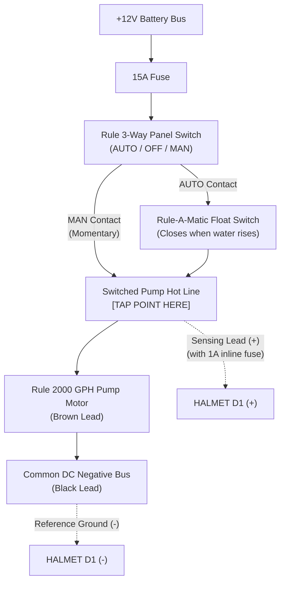
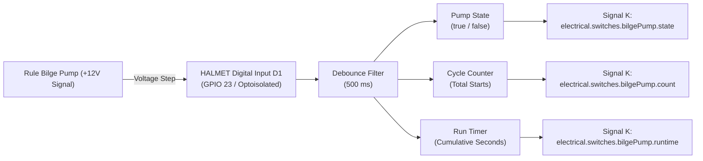

# Marine Bilge Pump Monitoring: Architecture & Wiring Guide

This document evaluates the electrical architecture, sensor requirements, and
wiring methods for monitoring bilge pump activity on a marine sailing yacht
using the **HALMET** gateway (or an ESP32 gateway running SensESP).

The specific installation evaluated is a standard marine bilge system
manufactured by **Rule Industries** composed of:
1. **Rule Submersible Bilge Pump** (2000 GPH, 12V DC, draws $\approx
   8.4\,\text{A}$).
2. **Rule Rule-A-Matic Float Switch** (mechanical float switch).
3. **Rule 3-Way Lighted Rocker Panel Switch** (Auto - Off - Manual, with
   integral indicator lamp and fuse).

The primary objective is detecting **how often the bilge pump turns on (cycle
count)** and **how long it runs (runtime duration)**, and streaming these
metrics to the NMEA 2000 backbone and Signal K / OpenPlotter dashboard.

---

## 1. Do You Need a Dedicated Sensor, or Can You Wire Directly?

> [!IMPORTANT] **No external sensor is required.** You do **not** need a
> separate flow sensor, current clamp, or second float switch. HALMET's
> isolated digital inputs (**D1–D4**) are specifically engineered to connect
> directly to the boat's $+12\,\text{V}$ electrical circuits via a simple
> tap/splice.

### Why HALMET Connects Directly to +12V:
1. **Wide Input Voltage Range:** HALMET's digital inputs accept voltages from
   **$-32\,\text{V}$ to $+32\,\text{V}$ DC**. A standard $+12\,\text{V}$ to
   $+14.4\,\text{V}$ boat battery voltage sits comfortably within this range.
2. **Built-In Schmitt Trigger Buffer:** Threshold voltage is $\approx
   1.55\,\text{V}$ with $\approx 0.7\,\text{V}$ hysteresis. When the pump is
   OFF ($0\,\text{V}$), the input reads logic LOW. When the pump runs
   ($+12\,\text{V}$), it reads logic HIGH cleanly without false triggers.
3. **Complete Galvanic Isolation:** HALMET features digital isolators
   separating the D1–D4 input terminals from the ESP32 microcontroller, I2C
   bus, and CAN/N2K transceivers. Splicing into a noisy $8.4\,\text{A}$
   inductive motor circuit will not inject voltage spikes, ground loops, or
   noise into your delicate navigation electronics.

---

## 2. Electrical Architecture of the Rule Bilge System

Understanding the wiring of the Rule 3-way rocker switch and Rule-A-Matic float
switch is essential for selecting the correct tap point:

### Analysis of the Circuit:
* **Manual Mode (MAN):** When you hold the spring-loaded rocker to MAN,
  $+12\,\text{V}$ flows directly from the switch to the pump's brown positive
  wire.
* **Automatic Mode (AUTO):** When the switch is in AUTO, $+12\,\text{V}$ is
  routed to the Rule-A-Matic float switch. When water lifts the float, the
  internal switch contacts close, routing $+12\,\text{V}$ to the pump's brown
  wire.
* **The "Switched Pump Hot" Line:** Regardless of *how* the pump turns on
  (whether automatically via the float switch or manually via the rocker
  switch), the **Brown positive lead** running directly into the pump motor
  becomes energized with $+12\,\text{V}$. When the pump stops, this line drops
  to $0\,\text{V}$ (tied to ground through the motor windings).

---

## 3. Splicing Options: Where to Tap the Signal

You can tap the $+12\,\text{V}$ switched line at two physical locations:

| Tap Location | Accessibility | Wire Run to HALMET | Splicing Complexity | Recommendation |
| :--- | :--- | :--- | :--- | :--- |
| **Option 1: Behind the Rule Switch Panel** | Very clean, dry, inside the main electrical console or helm panel. | Usually short ($< 1\text{ to }2\,\text{m}$) if HALMET is mounted near the main DC panel. | Tap the **MAN** output terminal or the indicator light feed using a piggyback spade or WAGO 221. | **Preferred (Cleanest & driest).** |
| **Option 2: Inside the Engine / Bilge Sump** | Wet, corrosive, prone to oil and water immersion. | Requires running 3–5 meters of wire from the bilge back to HALMET. | Requires waterproof adhesive heat-shrink butt splices or a sealed junction box. | Only if the switch panel is inaccessible. |

### 3.1 Option 1: Splicing Behind the Rule Switch Panel (Recommended)
The back of the Rule 3-way rocker switch panel features 0.250" (6.3 mm) male
quick-connect spade terminals:
1. Locate the terminal labeled **MAN / PUMP** (or the switched output lead
   running to the pump's brown wire).
2. Install a **Fully Insulated Piggyback Spade Terminal** (dual-male /
   single-female $6.3\,\text{mm}$ disconnect) onto that terminal.
3. Re-attach the original pump wire to one prong, and connect your sensing wire
   to the second prong.
4. Run a 2-conductor cable to HALMET:
   - **Conductor 1 (+):** Piggyback tap on the pump switched feed $\rightarrow$
     **HALMET D1 (+)**.
   - **Conductor 2 (-):** Connect to **any local DC negative busbar or ground
     terminal**.
     - *Does Ground Location Matter?* **No.** Because all negative returns on a
       12V boat system meet at the common battery negative bus, you do **not**
       need to drag a dedicated ground wire from the bilge switch. You can wire
       **HALMET D1 (-)** directly to the nearest DC negative terminal block or
       ground busbar located right next to the HALMET enclosure.

### 3.2 Inductive Kickback & Flyback Diodes: Marine Practice vs Electronics

In industrial DC motor control, putting a reverse-biased flyback diode across
an inductive load is standard practice to suppress the high-voltage spike
created when a coil or motor shuts off.

* **Is it standard marine practice?** **No.** You will virtually never see a
  flyback diode in Rule, Johnson Pump, or marine boat manufacturer wiring
  manuals. Marine DC bilge pumps are wired directly to mechanical float
  switches and rocker switches without external diodes. Mechanical contacts
  tolerate inductive arcing over years of infrequent bilge pumping.
* **Do you need one for HALMET?** **No.** HALMET's isolated digital inputs
  already incorporate onboard **TVS (Transient Voltage Suppressor) clamping
  diodes** and Schmitt trigger filtering capable of absorbing transient motor
  kickback spikes.
* **Why it was mentioned:** Some marine telemetry builders add a diode (e.g.
  1N5408) across the pump harness purely as a preventative measure to minimize
  contact pitting on the mechanical Rule-A-Matic float switch. It is entirely
  **optional** and not required for HALMET or your boat's operation.

---

## 4. Cable Gauge & Wiring Specification: 20 AWG vs 22/24 AWG

A common question is whether you can use thinner wire (such as 22 AWG or 24
AWG) instead of 20 AWG:

### 4.1 Electrical & Math Justification: Can You Go Thinner?
**Yes, electrically you can use 22 AWG ($0.34\,\text{mm}^2$) or 24 AWG
($0.22\,\text{mm}^2$).**

* **Current Calculation:** HALMET's digital inputs are high-impedance voltage
  sensing buffers with internal input resistance $R_{\text{in}} \ge
  100\,\text{k}\Omega$: $$I_{\text{sense}} =
  \frac{V_{\text{bat}}}{R_{\text{in}}} =
  \frac{13.8\,\text{V}}{100\,\text{k}\Omega} \approx 0.138\,\text{mA}\
  (138\,\mu\text{A})$$
* **Voltage Drop on 24 AWG Wire:**
  - 24 AWG resistance: $R \approx 0.084\,\Omega/\text{m}$.
  - Over a 5-meter run ($10\,\text{m}$ loop): $R_{\text{loop}} = 0.84\,\Omega$.
  - Voltage drop: $$\Delta V = 0.000138\,\text{A} \times 0.84\,\Omega \approx
    0.000116\,\text{V}\ (0.116\,\text{mV})$$
  - The voltage drop is essentially zero ($< 0.12\,\text{mV}$).
* **Why 18–20 AWG is typically cited in marine standards (ABYC E-11):** The
  American Boat and Yacht Council (ABYC) rule E-11.16 specifies a minimum
  conductor size of **16 AWG** for general boat wiring, with an exception
  permitting **18 AWG** or **20 AWG** (or thinner 22–24 AWG inside sheathed
  multiconductor cables) for electronic instrumentation. The restriction is
  strictly about **mechanical tensile strength** against engine vibration, not
  current capacity.
* **Recommendation:**
  - A sheathed **2-conductor 22 AWG ($0.34\,\text{mm}^2$) or 24 AWG
    ($0.22\,\text{mm}^2$) shielded cable** (such as GoTronic CBR222) is
    mechanically rugged, easy to strip, and electrically 100% fine.

### 4.2 Fusing for the Sensing Lead
Even though HALMET draws microamperes, any wire attached to a battery circuit
must be fused against catastrophic short-circuit if the wire insulation chafes:
* Insert a small **1A fast-blow fuse** (5x20 mm glass fuse or mini blade) right
  at the tap point behind the switch panel. $+12\,\text{V}$ battery circuit
  should have short-circuit protection against wire chafing.
  - Insert a small **1A inline fast-blow fuse** on the sensing wire right at
    the tap point behind the switch panel.

---

## 5. Software Configuration & Metrics (SensESP / Signal K)

Once connected to HALMET digital input **D1** (ESP32 GPIO 23), SensESP tracks
three distinct metrics from the single digital input:

### 5.1 Signal K Path Mapping
In the SensESP web interface or sketch configuration:

1. **Current Operating State (Running vs Stopped):**
   - **Signal K Path:** `electrical.switches.bilgePump.state`
   - **Type:** Boolean (`true` when pump is running, `false` when idle).
2. **Cycle Count (How Often It Turns On):**
   - **Signal K Path:** `electrical.switches.bilgePump.count`
   - **Description:** Increments on each rising edge ($0\,\text{V} \rightarrow
     12\,\text{V}$). Essential for detecting slow hull leaks or shaft seal
     dripping while away from the vessel.
3. **Cumulative Runtime (Total Seconds Run):**
   - **Signal K Path:** `electrical.switches.bilgePump.runtime`
   - **Description:** Accumulates seconds while the input remains HIGH.
4. **Volume Pumped (Derived Metric):**
   - Knowing the pump rating ($2000\,\text{GPH} \approx
     0.555\,\text{gallons/sec} \approx 2.1\,\text{L/sec}$), SensESP or Node-RED
     can calculate: $$\text{Estimated Volume (L)} = \text{Runtime (s)} \times
     2.1\,\text{L/s} \times 0.70\ (\text{head loss factor})$$

### 5.2 NMEA 2000 Integration & PGN Differences

HALMET broadcasts the bilge pump status onto the NMEA 2000 bus. Understanding
the difference between the two standard N2K PGNs:

1. **PGN 127501 (Binary Status Report):**
   - **Role:** Pure **state telemetry** (read-only indicator).
   - Reports the current ON or OFF condition of up to 28 discrete binary
     switches in a switch bank.
   - For the bilge pump, Bit 1 reports `0` (Pump Idle) or `1` (Pump Running).
   - Displayed on chartplotters (e.g. Raymarine Axiom, B&G Zeus) as a visual
     indicator icon on the digital switching / dashboard page.
2. **PGN 127502 (Binary Switch Control):**
   - **Role:** **Command & Control** (bidirectional actuator command).
   - Used when a multi-function display (MFD) or remote switch *commands* a
     digital relay to turn ON or OFF (e.g. CZone, EmpirBus).
   - In our direct-sensing setup, HALMET is purely *monitoring* an existing
     mechanical switch, so PGN 127502 is not used for pump actuation.

### 5.3 Configurable Bilge Alarms in Firmware

Can the trigger and silence conditions for bilge alarms be configured in your
own firmware code?

**Yes, completely.** Because HALMET runs an open ESP32 firmware stack (such as
SensESP / Arduino C++), you have 100% software control over the alarm logic:

1. **Continuous Run Alarm Threshold:**
   - In your firmware loop or SensESP transform, you start a timer when D1 goes
     HIGH.
   - If the pump runs continuously for longer than a configurable threshold
     (e.g. $> 60\,\text{seconds}$), the firmware triggers an emergency alert:
     - Emits **PGN 126983** (N2K Alert / Alarm), which triggers an audible beep
       and popup banner on Raymarine/B&G/Garmin MFDs.
     - Sets the Signal K notification path:
       `notifications.electrical.switches.bilgePump` with state `alarm`.
2. **Excessive Frequency / Cycle Alarm:**
   - If the pump cycles more than $N$ times within a rolling window (e.g. $> 5$
     cycles in 1 hour), trigger an alert for a slow hull/shaft leak.
3. **Alarm Reset / Silence Conditions:**
   - **Auto-Silence:** The alarm condition automatically clears when the pump
     stops and remains idle for 10 seconds.
   - **User Acknowledge:** Can be silenced or snoozed via a button press on the
     SensESP web interface or a physical button wired to another HALMET GPIO.

---

## 6. Sourcing Summary (with GoTronic France Part Numbers)

For builders located in France, **GoTronic (`gotronic.fr`)** provides all the
standard electronic components needed for the sensing tap with fast local
shipping:

| Item | Description | GoTronic Part & Link | Alternative / Notes |
| :--- | :--- | :--- | :--- |
| **Sensing Cable** | 2-conductor shielded cable (2 x 0.22 mm², black, 4 mm OD) | [Câble blindé CBR222 (Code: 48402)](https://www.gotronic.fr/art-cable-blindee-cbr222-48402.htm) | Perfect fit for 0.14 mA sensing run |
| **Terminal Taps** | Sachet 10 cosses Faston femelles 6.35 mm (0.5–1.0 mm²) | [Cosses FRF6 (Code: 09884)](https://www.gotronic.fr/art-10-cosses-frf6-09884.htm) | Faston disconnect for Rule switch |
| **Wire Connectors** | WAGO 221 lever nuts (3 conductors, 0.2–4 mm²) | [WAGO 221-413 (Code: 48707)](https://www.gotronic.fr/art-borne-wago-221-413-48707.htm) | Clean inline splicing without soldering |
| **Inline Fuse Holder**| 5x20 mm in-line fuse holder (chassis / solderable) | [Porte-fusible PF2 (Code: 09401)](https://www.gotronic.fr/art-porte-fusible-pf2-09401.htm) | Protects sensing wire at tap point |
| **1A Fast-Blow Fuse** | Fusible rapide 1.0 A (5 x 20 mm) | [Fusible rapide 1A (Code: 09311)](https://www.gotronic.fr/art-fusible-rapide-1-0-a-09311.htm) | Insert into inline fuse holder |
| **Optional Snubber Diode** | Diode de redressement 3A / 1000V DO-201AD | [Diode 1N5408 (Code: 02502)](https://www.gotronic.fr/art-10-diodes-1n5408-02502.htm) | Optional inductive kickback protection |
| **HALMET Gateway** | Marine Engine & Tank Interface (Hat Labs) | [Hat Labs HALMET](https://hatlabs.fi/) | Isolated digital inputs D1–D4 |
