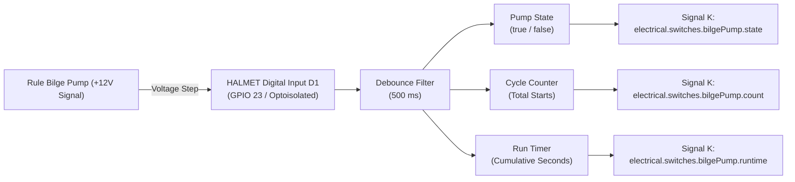

# Marine Bilge Pump Monitoring: Architecture & Wiring Guide

This document evaluates the electrical architecture, sensor requirements, and
wiring methods for monitoring bilge pump activity on a marine sailing yacht
using the **HALMET** gateway (or an ESP32 gateway running SensESP).

The specific installation evaluated is a standard marine bilge system
manufactured by **Rule Industries** composed of:
1. **Rule Submersible Bilge Pump** (2000 GPH, 12V DC, draws $\approx
   8.4\,\text{A}$).
2. **Rule Rule-A-Matic Float Switch** (mechanical float switch).
3. **Rule 3-Way Lighted Rocker Panel Switch** (Auto - Off - Manual, with
   integral indicator lamp and fuse).

The primary objective is detecting **how often the bilge pump turns on (cycle
count)** and **how long it runs (runtime duration)**, and streaming these
metrics to the NMEA 2000 backbone and Signal K / OpenPlotter dashboard.

---

## 1. Do You Need a Dedicated Sensor, or Can You Wire Directly?

> [!IMPORTANT] **No external sensor is required.** You do **not** need a
> separate flow sensor, current clamp, or second float switch. HALMET's
> isolated digital inputs (**D1–D4**) are specifically engineered to connect
> directly to the boat's $+12\,\text{V}$ electrical circuits via a simple
> tap/splice.

### Why HALMET Connects Directly to +12V:
1. **Wide Input Voltage Range:** HALMET's digital inputs accept voltages from
   **$-32\,\text{V}$ to $+32\,\text{V}$ DC**. A standard $+12\,\text{V}$ to
   $+14.4\,\text{V}$ boat battery voltage sits comfortably within this range.
2. **Built-In Schmitt Trigger Buffer:** Threshold voltage is $\approx
   1.55\,\text{V}$ with $\approx 0.7\,\text{V}$ hysteresis. When the pump is
   OFF ($0\,\text{V}$), the input reads logic LOW. When the pump runs
   ($+12\,\text{V}$), it reads logic HIGH cleanly without false triggers.
3. **Complete Galvanic Isolation:** HALMET features digital isolators
   separating the D1–D4 input terminals from the ESP32 microcontroller, I2C
   bus, and CAN/N2K transceivers. Splicing into a noisy $8.4\,\text{A}$
   inductive motor circuit will not inject voltage spikes, ground loops, or
   noise into your delicate navigation electronics.

---

## 2. Electrical Architecture of the Rule Bilge System

Understanding the wiring of the Rule 3-way rocker switch and Rule-A-Matic float
switch is essential for selecting the correct tap point:

```
                         [ +12V Battery Bus ]
                                  │
                                  ▼
                         [ Inline Fuse (15A) ]
                                  │
                                  ▼
                  +-------------------------------+
                  |  Rule 3-Way Panel Switch      |
                  |                               |
                  |  [AUTO]       [OFF]     [MAN] |
                  +----+----------------------+---+
                       │                      │
                       ▼                      │
             [ Rule-A-Matic Float ]           │
             (Closes when water rises)        │
                       │                      │
                       ▼                      │
                       +-----------+----------+
                                   │
                                   ├─── [TAP POINT HERE] ───> To HALMET Digital Input D1 (+)
                                   │
                                   ▼
                         [ Rule 2000GPH Pump ]
                         (Brown Positive Lead)
                                   │
                                   ▼ (Black Ground Lead)
                         [ Common Ground Bus ] ─────────────> To HALMET Digital Input D1 (-)
```

### Analysis of the Circuit:
* **Manual Mode (MAN):** When you hold the spring-loaded rocker to MAN,
  $+12\,\text{V}$ flows directly from the switch to the pump's brown positive
  wire.
* **Automatic Mode (AUTO):** When the switch is in AUTO, $+12\,\text{V}$ is
  routed to the Rule-A-Matic float switch. When water lifts the float, the
  internal switch contacts close, routing $+12\,\text{V}$ to the pump's brown
  wire.
* **The "Switched Pump Hot" Line:** Regardless of *how* the pump turns on
  (whether automatically via the float switch or manually via the rocker
  switch), the **Brown positive lead** running directly into the pump motor
  becomes energized with $+12\,\text{V}$. When the pump stops, this line drops
  to $0\,\text{V}$ (tied to ground through the motor windings).

---

## 3. Splicing Options: Where to Tap the Signal

You can tap the $+12\,\text{V}$ switched line at two physical locations:

| Tap Location | Accessibility | Wire Run to HALMET | Splicing Complexity | Recommendation |
| :--- | :--- | :--- | :--- | :--- |
| **Option 1: Behind the Rule Switch Panel** | Very clean, dry, inside the main electrical console or helm panel. | Usually short ($< 1\text{ to }2\,\text{m}$) if HALMET is mounted near the main DC panel. | Tap the **MAN** output terminal or the indicator light feed using a piggyback spade or WAGO 221. | **Preferred (Cleanest & driest).** |
| **Option 2: Inside the Engine / Bilge Sump** | Wet, corrosive, prone to oil and water immersion. | Requires running 3–5 meters of wire from the bilge back to HALMET. | Requires waterproof adhesive heat-shrink butt splices or a sealed junction box. | Only if the switch panel is inaccessible. |

### 3.1 Option 1: Splicing Behind the Rule Switch Panel (Recommended)
The back of the Rule 3-way rocker switch panel features 0.250" (6.3 mm) male
quick-connect spade terminals:
1. Locate the terminal labeled **MAN / PUMP** (or the switched output lead
   running to the pump's brown wire).
2. Install a **Fully Insulated Piggyback Spade Terminal** (dual-male /
   single-female $6.3\,\text{mm}$ disconnect) onto that terminal.
3. Re-attach the original pump wire to one prong, and connect your sensing wire
   to the second prong.
4. Run a 2-conductor cable to HALMET:
   - **Conductor 1 (+):** Piggyback tap on the pump switched feed $\rightarrow$
     **HALMET D1 (+)**.
   - **Conductor 2 (-):** Local DC negative busbar or panel ground
     $\rightarrow$ **HALMET D1 (-)**.

### 3.2 Inductive Kickback & Overvoltage Protection
When an inductive motor (such as the Rule 2000 GPH pump motor) shuts off, the
collapsing magnetic field generates a transient reverse-voltage spike
(inductive kickback).
* HALMET's input stage already features **TVS (Transient Voltage Suppressor)
  diodes** and overvoltage clamping up to $\pm 32\,\text{V}$ continuous and
  higher for nanosecond spikes.
* **Best Marine Practice:** For ultimate longevity of both the float switch
  contacts and electronic monitors, install an external **1N5408 or 1N4007
  flyback diode** in reverse-bias across the pump's $+12\,\text{V}$ and Ground
  wires (Cathode with stripe to $+12\,\text{V}$, Anode to Ground). This
  quenches arcing across the Rule-A-Matic switch contacts when the pump turns
  off.

---

## 4. Cable Gauge & Wiring Specification

Because HALMET's digital inputs draw microamperes ($I_{\text{in}} <
1\,\text{mA}$) purely to sense voltage logic levels:
* **Wire Gauge:** **$0.50\,\text{mm}^2\text{ to }0.75\,\text{mm}^2$** (**20 AWG
  or 18 AWG**). Heavy 14/16 AWG wire is not needed for the sensing run.
* **Cable Type:** Marine-grade tinned copper 2-conductor duplex cable (e.g.
  Ancor 18/2 or 20/2 AWG round marine wire).
* **Fusing for the Sensing Lead:**
  - Even though HALMET's input is protected, any wire connected to a
    $+12\,\text{V}$ battery circuit should have short-circuit protection
    against wire chafing.
  - Insert a small **1A inline fast-blow fuse** on the sensing wire right at
    the tap point behind the switch panel.

---

## 5. Software Configuration & Metrics (SensESP / Signal K)

Once connected to HALMET digital input **D1** (ESP32 GPIO 23), SensESP tracks
three distinct metrics from the single digital input:



### 5.1 Signal K Path Mapping
In the SensESP web interface or sketch configuration:

1. **Current Operating State (Running vs Stopped):**
   - **Signal K Path:** `electrical.switches.bilgePump.state`
   - **Type:** Boolean (`true` when pump is running, `false` when idle).
2. **Cycle Count (How Often It Turns On):**
   - **Signal K Path:** `electrical.switches.bilgePump.count`
   - **Description:** Increments on each rising edge ($0\,\text{V} \rightarrow
     12\,\text{V}$). Essential for detecting slow hull leaks or shaft seal
     dripping while away from the vessel.
3. **Cumulative Runtime (Total Seconds Run):**
   - **Signal K Path:** `electrical.switches.bilgePump.runtime`
   - **Description:** Accumulates seconds while the input remains HIGH.
4. **Volume Pumped (Derived Metric):**
   - Knowing the pump rating ($2000\,\text{GPH} \approx
     0.555\,\text{gallons/sec} \approx 2.1\,\text{L/sec}$), SensESP or Node-RED
     can calculate: $$\text{Estimated Volume (L)} = \text{Runtime (s)} \times
     2.1\,\text{L/s} \times 0.70\ (\text{head loss factor})$$

### 5.2 NMEA 2000 Integration
HALMET broadcasts the bilge pump status onto the NMEA 2000 bus via:
* **PGN 127501:** Binary Status Report (Switch Bank Status - Bilge On/Off).
* **PGN 127502:** Binary Switch Control.
* **PGN 126983:** Alert / Alarm (triggers MFD bilge alarm if runtime exceeds
  $60\,\text{seconds}$).

---

## 6. Sourcing Summary

| Item | Description | Supplier / SKU | Stock Status |
| :--- | :--- | :--- | :--- |
| **Piggyback Terminals** | 6.3 mm (0.250") insulated piggyback spade connectors | GoTronic / Marine stores | Widely Available |
| **Sensing Cable** | 2-conductor 18/2 or 20/2 AWG marine tinned wire | Ancor / Lapp / GoTronic | Widely Available |
| **Inline Fuse Holder** | Waterproof mini inline fuse holder + 1A fuse | GoTronic / Auto / Marine | Widely Available |
| **Flyback Diode** | 1N5408 (3A 1000V) or 1N4007 inductive snubber diode | Mouser / GoTronic | In Stock |
| **HALMET Gateway** | Marine Engine & Tank Interface (Hat Labs) | Hat Labs | Available |
