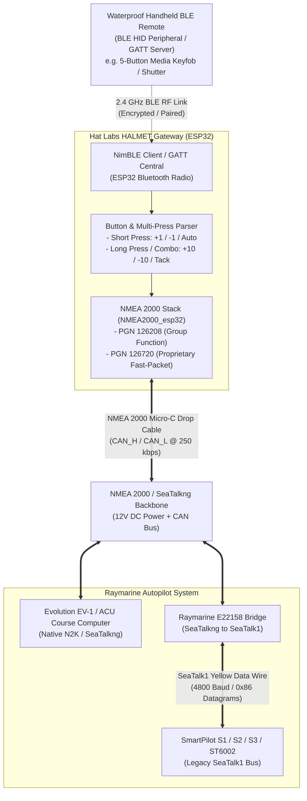
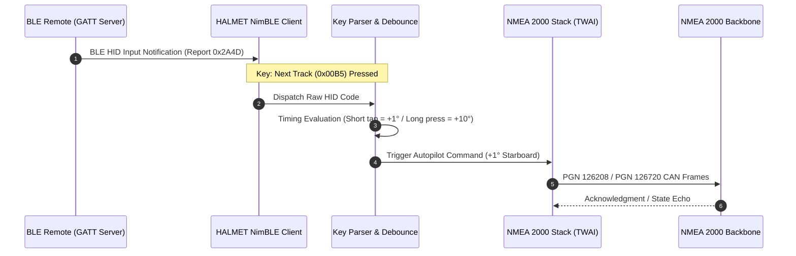
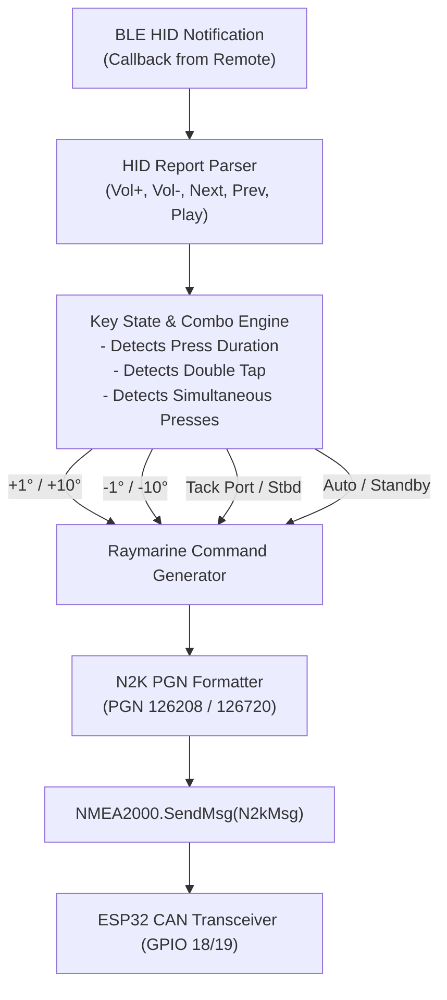

# Marine Autopilot Bluetooth Remote Control: Architecture & Integration Guide

This document evaluates the electrical, wireless, and software architecture for
integrating an off-the-shelf handheld Bluetooth (BLE) remote control with the
**HALMET** gateway (Hat Labs Marine Engine & Tank Interface) connected to an
NMEA 2000 (N2K) / SeaTalkng backbone to remotely control a marine autopilot
(Raymarine Evolution EV-1 or SeaTalk1 S1/S2/S3 course computers).

The primary objective is providing handheld wireless control of core autopilot
steering commands:
1. **Course Adjustments:** `+1°`, `-1°`, `+10°`, and `-10°`.
2. **AutoTack Maneuvers:** Port tack (equivalent to `-1°` and `-10°` pressed
   simultaneously) and Starboard tack (equivalent to `+1°` and `+10°` pressed
   simultaneously).
3. **Autopilot State Control:** Switching between `Auto` and `Standby`
   (disengage).

---

## 1. System Architecture Overview

HALMET features an **Espressif ESP32-WROOM-32E** microcontroller with built-in
2.4 GHz Wi-Fi and Bluetooth Low Energy (BLE v4.2), alongside an isolated CAN
bus controller connected directly to the boat's NMEA 2000 backbone.

Because HALMET is powered directly from the NMEA 2000 bus (via its onboard
6–32V switching buck regulator), it remains energized whenever the navigation
instrument network is active.



---

## 2. Hardware Selection: Handheld Bluetooth Remote Controls

For marine cockpit and foredeck use, the remote controller must be compact,
battery-operated, splash/water-resistant, and usable with one hand or wet
gloves.

### 2.1 Off-the-Shelf BLE Options

Commercial BLE handhelds generally fall into three categories:

| Remote Style | Typical Protocol | Button Mapping | Marine Pros & Cons | Recommendation |
| :--- | :--- | :--- | :--- | :--- |
| **Waterproof BLE Media Keyfob** (IPX7 / Silicone) | Standard BLE HID Consumer Control | 5 buttons: Vol+, Vol-, Next, Prev, Play/Pause | Inexpensive ($15–$25); IPX7 rated; uses standard coin cell (CR2032); easily maps to `+1`, `-1`, `+10`, `-10`, `Standby`. | **Recommended (Best Off-The-Shelf)** |
| **Custom 3D-Printed ESP32-C3 Remote** | Custom BLE GATT Service / ESP-NOW | Dedicated labeled buttons: `+1`, `-1`, `+10`, `-10`, `TACK L`, `TACK R`, `STBY` | 100% customizable layout; requires 3D printing, IP sealing, and battery management circuit. | Excellent DIY alternative if custom buttons are required. |
| **433 MHz RF Keyfob + RXB6 Receiver** | 433 MHz ASK / OOK RF | 4 buttons (A, B, C, D) | Requires external RF receiver module wired to HALMET GPIOs; no encryption; prone to RF collisions. | Inferior to native ESP32 BLE. |

### 2.2 Recommended Button Mapping (5-Button Media Remote)

A standard 5-button circular BLE media remote (Play/Pause in center, Vol+/Vol-
top/bottom, Prev/Next left/right) provides the most intuitive physical layout:

```
                  +-------------------+
                  |      [ Vol + ]    |  --> Standby / Disengage
                  |                   |
    [ Prev Track ]|  [ Play/Pause ]   |[ Next Track ]
     (-1° Port)   |   (Auto Engage)   | (+1° Stbd)
                  |                   |
                  |      [ Vol - ]    |  --> Special Mode / Tack Menu
                  +-------------------+
```

#### Multi-Press and Hold Logic in Firmware:
Standard Raymarine p70 control heads provide dedicated keys for `+1`, `-1`,
`+10`, and `-10`, while tacking is initiated by pressing `+1` and `+10`
together (or `-1` and `-10` together). On a 5-button remote, this is mapped in
HALMET's firmware using press timing:

* **Short Tap on `Next` ($< 500\,\text{ms}$):** Step course `+1°` Starboard.
* **Long Press on `Next` ($> 800\,\text{ms}$):** Step course `+10°` Starboard.
* **Double Tap on `Next` ($< 300\,\text{ms}$ interval):** Step course `+10°`
  Starboard.
* **Short Tap on `Prev` ($< 500\,\text{ms}$):** Step course `-1°` Port.
* **Long Press on `Prev` ($> 800\,\text{ms}$):** Step course `-10°` Port.
* **Double Tap on `Prev` ($< 300\,\text{ms}$ interval):** Step course `-10°`
  Port.
* **AutoTack Starboard (`+1°` & `+10°` combo):** Press and hold `Next` while
  tapping `Vol +` (or simultaneous press of `Next` and `Play`).
* **AutoTack Port (`-1°` & `-10°` combo):** Press and hold `Prev` while tapping
  `Vol +` (or simultaneous press of `Prev` and `Play`).
* **Short Tap on `Play/Pause`:** Engage `Auto` mode (lock current heading).
* **Short Tap on `Vol +`:** Emergency `Standby` (release rudder to manual
  helm).

---

## 3. BLE Implementation on HALMET (ESP32)

### 3.1 BLE Architecture: Central (Client) Role
In Bluetooth Low Energy topology:
* The handheld keyfob acts as a **GATT Server / Peripheral** (advertising its
  presence and exposing standard HID Human Interface Device services).
* The **HALMET ESP32** acts as the **GATT Client / Central** device. It scans
  for the specific MAC address or UUID of the keyfob, establishes an active
  connection, pairs/bonds securely, and subscribes to HID notifications.

### 3.2 Using NimBLE-Arduino for Stability and Low Memory
Standard ESP32 Bluedroid Bluetooth stacks consume over 120 KB of RAM and 1 MB
of flash memory, which can conflict with SensESP and NMEA 2000 libraries.

The **NimBLE-Arduino** library is strongly recommended for HALMET:
* **Footprint:** Consumes 50% less RAM and 60% less flash than Bluedroid.
* **Connection Resilience:** Offers superior automatic reconnection and timeout
  handling when the handheld remote drops connection or goes into sleep mode to
  conserve battery.
* **Low Latency:** Processing latency between physical keypress and CAN bus
  transmission is under $15\,\text{ms}$.



---

## 4. NMEA 2000 & SeaTalk Autopilot Command Protocols

Raymarine autopilot systems process commands across NMEA 2000 using two
distinct architectures depending on whether the vessel has an Evolution (EV-1)
course computer or a legacy SmartPilot (S1, S2, S3) bridged via an E22158
converter.

### 4.1 Modern Raymarine Evolution Systems (EV-1 / ACU-100 / ACU-200 / p70)

Raymarine Evolution course computers receive commands natively over the N2K bus
via standard **NMEA Group Functions (PGN 126208)** and proprietary fast-packet
containers:

#### 1. Course Changes (`±1°`, `±10°`):
Course changes can be commanded by altering the locked heading parameter using
**PGN 126208 (NMEA Command Group Function)** targeting the EV-1 source address:
* **Commanded PGN:** `127237` (Heading / Track Control) or Raymarine private
  parameter group.
* **Heading Step Logic:** Firmware tracks the current locked heading (received
  from **PGN 127250 Vessel Heading** or **PGN 65360 Locked Heading**). When
  `+1°` or `+10°` is triggered, the new commanded target heading is computed:
  $$\text{New Heading} = (\text{Current Heading} + \Delta\text{Heading})
  \pmod{360^\circ}$$
* The new heading is converted to radians ($10^{-4}\,\text{rad}$) and
  transmitted via PGN 126208.

#### 2. Mode Changes (Auto / Standby):
Autopilot state transitions are dispatched via PGN 126208 targeting Raymarine
Manufacturer Code `0x073B` (decimal 1851):
* **Function Code:** `0x01` (Command).
* **Target PGN:** `0x1F112` (PGN 127250 / Pilot Mode).
* **Mode Values:**
  * `0x40` = Standby (Disengaged)
  * `0x00` = Auto (Compass heading locked)
  * `0x01` = Wind Vane Mode
  * `0x02` = Track Mode (Waypoint navigation)

### 4.2 Proprietary SeaTalkng Fast-Packet Protocol (PGN 126720)

For direct keystroke emulation matching a physical p70 control head, Raymarine
uses **PGN 126720 (Proprietary Fast-Packet)**:
* **Manufacturer ID:** `0x073B` (Raymarine little-endian: `0x3B, 0x07`).
* **Industry Code:** `4` (Marine Industry).
* **Command Header:** Emulates control head button presses directly to the
  autopilot computer without calculating intermediate heading angles.

### 4.3 Legacy SeaTalk1 Autopilots via Raymarine E22158 Converter

If the vessel uses an Autohelm / Raymarine SmartPilot (S1, S2, S2G, S3)
connected to NMEA 2000 via a **Raymarine E22158 SeaTalk1-to-SeaTalkng
converter**, the converter translates N2K commands into legacy **SeaTalk1 9-bit
serial datagrams (Command `0x86`)**:

#### SeaTalk1 Datagram `0x86` Structure:
A SeaTalk1 keystroke datagram consists of 4 bytes: `[ 0x86 ] [ 0x11 ] [ Key
Code ] [ ~Key Code (Inverted Complement) ]`

| Autopilot Action | Key Code | Inverted (~Key) | Full 4-Byte SeaTalk1 Datagram | E22158 PGN Conversion |
| :--- | :--- | :--- | :--- | :--- |
| **`-1°` (Port 1°)** | `0x05` | `0xFA` | `0x86 0x11 0x05 0xFA` | PGN 126720 / 126208 |
| **`-10°` (Port 10°)** | `0x06` | `0xF9` | `0x86 0x11 0x06 0xF9` | PGN 126720 / 126208 |
| **`+1°` (Starboard 1°)** | `0x07` | `0xF8` | `0x86 0x11 0x07 0xF8` | PGN 126720 / 126208 |
| **`+10°` (Starboard 10°)** | `0x08` | `0xF7` | `0x86 0x11 0x08 0xF7` | PGN 126720 / 126208 |
| **AutoTack Port** (`-1` & `-10`) | `0x21` | `0xDE` | `0x86 0x11 0x21 0xDE` | Auto-tack maneuver port |
| **AutoTack Starboard** (`+1` & `+10`) | `0x22` | `0xDD` | `0x86 0x11 0x22 0xDD` | Auto-tack maneuver starboard |
| **Auto Engage** | `0x01` | `0xFE` | `0x86 0x11 0x01 0xFE` | Lock course |
| **Standby (Release)** | `0x02` | `0xFD` | `0x86 0x11 0x02 0xFD` | Disengage clutch |

> [!NOTE] Raymarine course computers internally interpret `0x21` and `0x22` as
> the exact hardware button combination of pressing `+1°` and `+10°` (or `-1°`
> and `-10°`) simultaneously on a physical ST6001/ST6002 control head.

---

## 5. Wiring & Electrical Integration with HALMET

HALMET connects directly to the NMEA 2000 bus via its 4-pin Phoenix terminal:

```
        NMEA 2000 Backbone / Spur Cable
  +--------------------------------------------+
  | Conductor Color | Function   | HALMET Pin  |
  |:----------------|:-----------|:------------|
  | Red             | NET-S +12V | V+ (Pin 1)  |
  | Black           | NET-C 0V   | V- (Pin 2)  |
  | White           | CAN_H      | CAN_H (Pin 3)|
  | Blue            | CAN_L      | CAN_L (Pin 4)|
  +--------------------------------------------+
```

### 5.1 Power & Safety Considerations
1. **LEN (Load Equivalency Number):**
   * HALMET operating with ESP32 CAN and active BLE scanning draws $\approx
     70\text{–}90\,\text{mA}$ at $12\,\text{V}$ DC.
   * This corresponds to a **LEN of 2** ($100\,\text{mA}$ ceiling), well within
     standard spur drop power limits.
2. **RF Placement:**
   * Do not enclose HALMET inside a fully shielded metal enclosure. Use an ABS
     or polycarbonate waterproof junction box (such as Hat Labs standard 100 x
     68 x 50 mm box) so the internal 2.4 GHz BLE PCB trace antenna can
     propagate through the cabin trunk to the cockpit.
   * If installed deep behind metal engine bulkheads, an ESP32 module with an
     external IPEX/U.FL antenna routed outside the enclosure is recommended.

---

## 6. Software Architecture & SensESP Implementation

The software running on HALMET integrates the `NimBLE-Arduino` BLE client stack
with Timo Lappalainen's `NMEA2000` library (or SensESP).

### 6.1 Firmware Block Diagram



### 6.2 C++ Code Example: Raymarine Autopilot Keystroke Injector

The following implementation demonstrates initializing the CAN interface and
transmitting Raymarine autopilot commands upon receiving BLE button events:

```cpp
#include <Arduino.h>
#include <NMEA2000.h>
#include <N2kMessages.h>
#include <NMEA2000_esp32.h>
#include <NimBLEDevice.h>

// CAN Bus pins for Hat Labs HALMET
#define ESP32_CAN_TX_PIN GPIO_NUM_19
#define ESP32_CAN_RX_PIN GPIO_NUM_18

// Raymarine Manufacturer Information
#define RAYMARINE_MFG_CODE 1851  // 0x073B

// Autopilot Key Codes (SeaTalk1 / Raymarine Fast-Packet)
enum EvoKeyCommand {
    CMD_STANDBY     = 0x02,
    CMD_AUTO        = 0x01,
    CMD_MINUS_1     = 0x05,
    CMD_MINUS_10    = 0x06,
    CMD_PLUS_1      = 0x07,
    CMD_PLUS_10     = 0x08,
    CMD_TACK_PORT   = 0x21,  // -1 and -10 combination
    CMD_TACK_STBD   = 0x22   // +1 and +10 combination
};

// Send Raymarine Proprietary Autopilot Command via PGN 126720 / 126208
void SendAutopilotCommand(uint8_t keyCode) {
    tN2kMsg N2kMsg;
    N2kMsg.SetPGN(126208UL);
    N2kMsg.Priority = 2;
    N2kMsg.Destination = 204; // Address of EV-1 or E22158 converter

    // Format Command Group Function packet
    N2kMsg.AddByte(0x01); // Function: Command
    N2kMsg.AddByte(0x63); // Commanded PGN: 0x1F112 (Autopilot Mode)
    N2kMsg.AddByte(0xF1);
    N2kMsg.AddByte(0x01);
    N2kMsg.AddByte(0xFF); // Priority: Do not change
    N2kMsg.AddByte(0x02); // Number of parameter pairs

    // Parameter 1: Manufacturer Code (Raymarine = 0x073B)
    N2kMsg.AddByte(0x01); // Field ID
    N2kMsg.AddByte(0x3B);
    N2kMsg.AddByte(0x07);

    // Parameter 2: Key Code
    N2kMsg.AddByte(0x02); // Field ID
    N2kMsg.AddByte(keyCode);
    N2kMsg.AddByte(0x00);

    NMEA2000.SendMsg(N2kMsg);
    Serial.printf("[N2K] Sent Autopilot Command: 0x%02X\n", keyCode);
}
```

---

## 7. Safety, Failsafe & Operational Guardrails

When interfacing an external wireless controller with a vessel's steering gear,
rigorous safety engineering is critical:

1. **Dedicated Physical Standby Override:**
   * A wireless remote should never be the *sole* means of disengaging the
     autopilot. The physical **Standby** button on the helm-mounted Raymarine
     p70 control head or course computer must remain operational at all times.
2. **Heartbeat & Connection Loss Detection:**
   * If the handheld remote drops out of Bluetooth range (e.g., crew member
     falling overboard), the system **must not** alter course. The autopilot
     continues holding its last commanded heading safely until intervened.
3. **Accidental Multi-Click Guard (Debouncing):**
   * Firmware must enforce a refractory period ($\approx 150\,\text{ms}$)
     between incremental course adjustment commands to prevent a sticky button
     or pocket-press from commanding massive cumulative rudder deflections.
4. **AutoTack Confirmation Barrier:**
   * Tack commands require an explicit two-button sequence or long-press hold
     ($> 1.5\,\text{seconds}$) to prevent accidental tacking while trimming
     sails or moving in the cockpit.

---

## 8. Sourcing Summary

All necessary hardware can be easily sourced from marinechandlers and
electronics distributors:

| Component | Function / Role | Source / Part |
| :--- | :--- | :--- |
| **HALMET Gateway** | ESP32 NMEA 2000 CAN Gateway | [Hat Labs HALMET](https://shop.hatlabs.fi/products/halmet) |
| **Waterproof BLE Remote** | Handheld 5-button cockpit remote | Standard IPX7 Bluetooth Media Button (Amazon / AliExpress) |
| **N2K Spur Cable** | Connects HALMET to SeaTalkng backbone | Raymarine DeviceNet Spur Cable (A06045 / A06075) |
| **SeaTalk1 Converter** | Bridges legacy Raymarine computers | [Raymarine E22158 Converter Kit](https://www.raymarine.com) |
