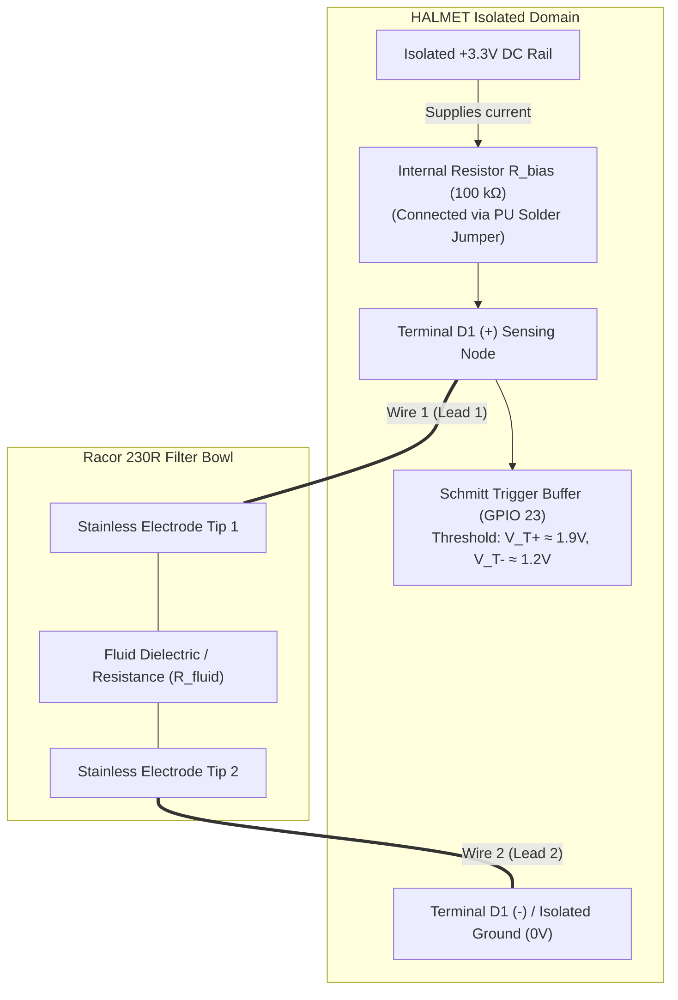
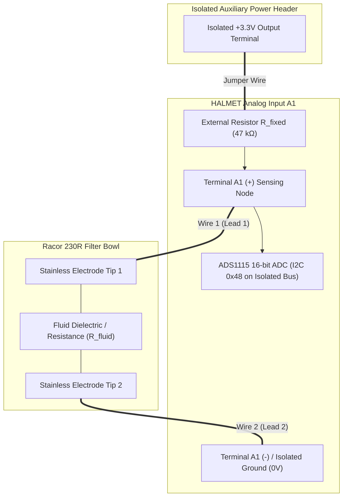

# Racor 230R Water-in-Fuel (WIF) Sensor Integration with HALMET

This document details how to interface the Water-in-Fuel (WIF) detection probe
for the **Parker Racor 230R** spin-on fuel filter / water separator with the
**HALMET** board, and broadcast real-time alarms via **NMEA 2000** (preferred)
and **Signal K**.

---

## 1. System Overview & Sensor Architecture

The Parker Racor 200 Series (specifically the 230R spin-on filter) separates
emulsified and free water from diesel fuel. As water is denser than diesel, it
settles at the base of the transparent or metal bowl.

```
       +---------------------------------------------+
       |           Racor 230R Filter Bowl            |
       |                                             |
       |  [ Diesel Fuel Layer ] (Non-conductive)     |
       |                                             |
       | - - - - - - - - - - - - - - - - - - - - - - |
       |  [ Water Accumulation ] (Conductive)        |
       |                                             |
       |         [+] Tip           [-] Tip           |
       +----------|-------------------|--------------+
                  |   Racor RK21069   |
                  | 1/2"-20 UNF Probe |
                  +---------+---------+
                            |
                     (2-Wire Pigtail)
                            |
           [ Passive Resistive Water Bridge ]
                            |
                            v
       +---------------------------------------------+
       |         HALMET Marine Interface Board       |
       |                                             |
       |  Option A: Digital Input (D1–D4 w/ Pull-up) |
       |  Option B: Analog Input  (A1–A4 w/ Divider) |
       |                                             |
       |  - Galvanically Isolated Input Domain       |
       |  - ESP32 Firmware (SensESP / NMEA2000)      |
       +--------------------+------------------------+
                            |
              +-------------+-------------+
              |                           |
              v                           v
     [ NMEA 2000 Bus ]              [ Signal K ]
      PGN 127489 (Engine)         propulsion.main.
      Bit 8: Water In Fuel        waterInFuel: true
```

### 1.1 The Racor RK 21069 Water Probe
* **Part Number:** **Racor RK 21069** (or RK 21069-01 / RK 21069-02).
* **Thread Fitting:** **1/2"-20 UNF** with an integrated Buna-N O-ring that
  threads into the bottom port of the Racor 230R bowl.
* **Electrical Working Principle:**
  - The probe consists of **two exposed stainless-steel electrode tips**
    separated by a fixed gap inside the bowl cavity.
  - **In Clean Diesel Fuel:** Hydrocarbons are non-polar dielectric fluids.
    Electrical resistance across the tips is virtually infinite ($R >
    10\,\text{M}\Omega$).
  - **In Water:** Water (especially marine condensation or brackish wash) is
    conductive. When water rises to bridge both electrodes, electrical
    resistance drops drastically to **$< 47\,\text{k}\Omega \text{ -- }
    100\,\text{k}\Omega$**.
* **Crucial Electrical Rule:** The RK 21069 is a **purely passive continuity
  probe with NO internal series resistor**. It must **NEVER** be connected
  directly across 12 V / 24 V battery power and ground, as that would pass
  uncontrolled current through the fuel, cause electrolytic degradation of the
  pins, and create a short-circuit hazard.

---

## 2. Real-World Electrical Resistance of Water in Diesel & Industry Thresholds

Understanding real-world resistance values is critical for a dependable
hardware integration. The electrical values used in this specification are
grounded in official Parker Racor engineering manuals, diesel injection
standards, and real-world DIY marine and automotive telemetry implementations.

### 2.1 The Electrochemical Working Principle

* **Clean Diesel Fuel:** Pure hydrocarbons are non-polar dielectric fluids.
  Hydrocarbons have virtually zero free ions and an extremely low dielectric
  constant ($\varepsilon_r \approx 2.1$). In clean diesel fuel or dry air, the
  resistance measured between the two stainless steel probe tips is
  **infinite** ($R > 10\,\text{M}\Omega$ to $50\,\text{M}\Omega$).
* **Water in Fuel:** Water separated from marine diesel is never distilled
  water. It originates from atmospheric condensation inside fuel tanks, tanker
  delivery moisture, or salt spray ingression through tank vent lines. It
  contains dissolved mineral ions, traces of fuel sulfur compounds, and salts,
  forming an **ionic electrolyte solution**:
  - **Salt Water / Seawater Contamination:** Extremely high ionic conductance
    ($\sigma \approx 50{,}000\,\mu\text{S/cm}$). Probe resistance drops to
    **$200\,\Omega \text{ to } 2{,}000\,\Omega$**.
  - **Engine Tank Condensation (Typical Marine):** Moderate ionic conductance
    ($\sigma \approx 100 \text{ to } 500\,\mu\text{S/cm}$). Probe resistance
    settles between **$5\,\text{k}\Omega \text{ and } 35\,\text{k}\Omega$**.
  - **Very Pure Fresh Rainwater Condensation:** Low ionic conductance ($\sigma
    \approx 20 \text{ to } 50\,\mu\text{S/cm}$). Probe resistance ranges from
    **$35\,\text{k}\Omega \text{ to } 70\,\text{k}\Omega$**.

### 2.2 Manufacturer Trigger Thresholds & Official Technical Documentation

To verify how the sensor operates across marine diesel filtration systems:

1. **Parker Racor Parts, Service & Technical Information Guide:**
   - According to the official [Parker Racor Parts, Service & Technical
     Information Guide](
     https://marinedieselbasics.com/wp-content/uploads/edd/Racor-Parts-Service-Technical-Info-Guide.pdf)
     (Section on *Water Detection Kits & Modules*):
     - The passive in-bowl probe (RK 21069) acts as a conductivity switch.
     - An electronic detection module analyzes the electrical resistance
       between the sensor tips.
     - The system activates when water bridges the probe tips and measured
       resistance falls below **$47{,}000\,\Omega$ ($47\,\text{k}\Omega$) to
       $100{,}000\,\Omega$ ($100\,\text{k}\Omega$)**, depending on the
       electronic detection module model used.
2. **Parker Racor Factory Module Models:**
   - **Passive Probes (RK 21069):** 1/2"-20 UNF thread, 2-wire pigtail, no
     internal electronics. Must be connected to a sensing circuit.
   - **Under-Dash Modules (RK 20725 / RK 12870):** Traditional comparator
     circuits designed with high sensitivity ($100\,\text{k}\Omega$ threshold)
     to detect low-mineral condensation.
   - **Integrated Probes & Gauge Modules (RK 30880E / RK 20726):** Solid-state
     units calibrated to an exact **$47\,\text{k}\Omega$ ($\pm 10\%$)**
     threshold, optimized for marine noise immunity against microbial fuel
     slime.
3. **Heavy-Duty Commercial Diesel Benchmark (DAVCO Fuel Pro):**
   - In heavy-duty commercial diesel filtration, DAVCO Water-in-Fuel sensors
     (such as DAVCO Part #232617 / #102511 used on Fuel Pro 382/482 processors)
     explicitly specify testing resistance:
     - Target baseline resistance: **$82\,\text{k}\Omega \pm 5\%$** (acceptable
       bench test range: $77.9\,\text{k}\Omega \text{ to }
       86.1\,\text{k}\Omega$ per DAVCO Technical Service Bulletin F3090 / WIF
       Testing Specifications).
     - The engine ECM monitors this continuous $82\,\text{k}\Omega$ circuit to
       verify sensor presence; when water enters the bowl, the low-resistance
       water path shunts this resistance toward ground, asserting the fault
       code.
4. **Marine Field Observations & Bench Testing:**
   - **Bench Meter Testing:** On marine diesel engines, testing an uninstalled
     or dry probe with a digital multimeter in resistance mode ($\Omega$) reads
     strictly **open-circuit / over-limit (`O.L.`)**. Dipping the tips into a
     cup of tap water or brackish water immediately registers between
     **$5\,\text{k}\Omega \text{ and } 35\,\text{k}\Omega$**.
   - **Field False-Alarm Modes:** When boaters experience "ghost" or false
     water-in-fuel alarms with clean fuel, troubleshooting typically reveals
     one of two electrical issues:
     1. Conductive asphalt, carbon, or microbial biomass slime coating the
        insulator between the stainless pins, creating a parasitic leakage path
        in the $40\text{--}80\,\text{k}\Omega$ range (resolved by cleaning with
        solvent or fine scotch-brite).
     2. Moisture or salt-air tracking inside the external wiring connector
        harness plug, which forms a parallel conductive bridge. Cleaning and
        sealing the harness plug eliminates the false trigger.

### 2.3 Operating Analysis: Digital Input (Option 1) vs Analog Input (Option 2)

A key question is whether **Option 1 (HALMET Digital Input D1)** operates
reliably across the entire **$47\,\text{k}\Omega \text{ to }
100\,\text{k}\Omega$** range documented by Parker Racor:

* **HALMET Digital Schmitt Buffer Thresholds:** HALMET's digital inputs (GPIO
  23 for D1) use a 3.3V Schmitt trigger buffer:
  - Input Low Threshold ($V_{T-}$): Nominal $\sim 1.2\,\text{V}$ (typical logic
    low transition occurs between $1.2\,\text{V}$ and $1.5\,\text{V}$).
  - Input High Threshold ($V_{T+}$): Nominal $\sim 1.9\,\text{V}$.
  - Onboard Pull-up Resistor ($R_{\text{bias}}$): Fixed $100\,\text{k}\Omega$
    connected to $+3.3\,\text{V}$ via bottom solder jumper **PU**.

* **Formula for Digital Sense Voltage:** $$V_{\text{sense}} = 3.3\,\text{V}
  \times \frac{R_{\text{fluid}}}{100\,\text{k}\Omega + R_{\text{fluid}}}$$

* **Verification Across the $47\,\text{k}\Omega \text{ to }
  100\,\text{k}\Omega$ Range:**
  1. **At Lower Racor Threshold ($R_{\text{fluid}} = 47\,\text{k}\Omega$):**
     $$V_{\text{sense}} = 3.3\,\text{V} \times
     \frac{47\,\text{k}\Omega}{100\,\text{k}\Omega + 47\,\text{k}\Omega} =
     3.3\,\text{V} \times 0.320 = 1.05\,\text{V}$$ Because $1.05\,\text{V} \le
     1.2\,\text{V}$ ($V_{T-}$), the Schmitt trigger firmly flips to **Logic LOW
     (Alarm Triggered)**. This covers all modern electronic modules (RK 30880E
     / RK 20726 standard).
  2. **At Upper Racor Threshold ($R_{\text{fluid}} = 100\,\text{k}\Omega$):**
     $$V_{\text{sense}} = 3.3\,\text{V} \times
     \frac{100\,\text{k}\Omega}{100\,\text{k}\Omega + 100\,\text{k}\Omega} =
     3.3\,\text{V} \times 0.500 = 1.65\,\text{V}$$ Because $1.65\,\text{V}$ is
     close to the Schmitt center switching region ($1.55\,\text{V}$ nominal), a
     high-resistance bridge of exactly $100\,\text{k}\Omega$ may hover near the
     transition zone and not guarantee an immediate digital low transition on
     every board sample.
  3. **How Real Water Actually Behaves:** When free water reaches the probe
     tips, water is an electrolyte:
     - Brackish / salt water contamination drops resistance to **$<
       2\,\text{k}\Omega$** ($V_{\text{sense}} \le 0.06\,\text{V}$).
     - Standard engine tank condensation drops resistance to
       **$5\,\text{k}\Omega \text{ to } 35\,\text{k}\Omega$**
       ($V_{\text{sense}} \le 0.85\,\text{V}$).
     - In both real-world conditions, $V_{\text{sense}}$ drops well below
       $1.05\,\text{V}$, ensuring **Option 1 will trigger reliably**.
  4. **To Guarantee 100% Coverage of the Full $100\,\text{k}\Omega$
     High-Sensitivity Window:**
     - **Option 1 with External Pull-Up:** If you prefer digital operation but
       want guaranteed triggering up to $100\,\text{k}\Omega$
       ($V_{\text{sense}} \le 1.2\,\text{V}$), you can connect an external
       **$180\,\text{k}\Omega$ to $200\,\text{k}\Omega$** resistor between
       Isolated 3.3V and D1 (+) instead of enabling the onboard
       $100\,\text{k}\Omega$ jumper. At $R_{\text{fluid}} =
       100\,\text{k}\Omega$ and $R_{\text{bias}} = 180\,\text{k}\Omega$:
       $$V_{\text{sense}} = 3.3\,\text{V} \times
       \frac{100\,\text{k}\Omega}{180\,\text{k}\Omega + 100\,\text{k}\Omega} =
       1.18\,\text{V} \quad (\le V_{T-})$$
     - **Option 2 (Analog Input A1 via ADS1115):** The ADC measures continuous
       voltage with 16-bit precision. You can define any threshold in software
       (e.g. $R_{\text{fluid}} \le 100\,\text{k}\Omega$ trips at $V_{\text{A1}}
       \le 2.24\,\text{V}$ with a $47\,\text{k}\Omega$ bias resistor),
       providing total software adjustability with zero hardware guessing.

* **Corrosion & Electrolysis Prevention:** A common finding in DIY water probe
  implementations is that applying continuous high DC current across submerged
  metal electrodes causes electrolytic oxidation (eroding the positive pin). In
  our HALMET circuit:
  - The $47\,\text{k}\Omega \text{ to } 100\,\text{k}\Omega$ bias resistor
    limits the maximum current through the fluid to less than
    **$70\,\mu\text{A}$** ($0.07\,\text{mA}$).
  - In normal operation (clean diesel), the circuit is open and current is $<
    0.3\,\mu\text{A}$.
  - This negligible current produces zero electrolytic erosion, preserving the
    stainless steel probe indefinitely.

---

## 3. HALMET Hardware Interfacing Options

HALMET provides four **galvanically isolated digital inputs (D1–D4)** and four
**galvanically isolated analog inputs (A1–A4)**. The field wiring side operates
in its own isolated power domain powered by an onboard isolated DC/DC converter
and digital isolators, completely protecting the ESP32 and NMEA 2000 CAN bus
from ground loops or high-voltage transients.

Two wiring configurations can be used to interface the passive Racor probe:

---

### 3.1 Option 1: Digital Input (D1–D4) with Onboard Bias Resistor

Rather than requiring any external components, this option relies on HALMET's
onboard configurable bias resistor connected to the digital input buffer.

#### 2.1.1 Physical Circuit Connections & Solder Jumper
HALMET's printed circuit board has solder jumper pads on its bottom surface
associated with each digital input channel (D1 to D4).
* On the underside of the board, locate the three solder pads for channel
  **D1**.
* Bridging the center pad to the pad marked **PU** physically solders an
  internal **$100\,\text{k}\Omega$ fixed resistor ($R_{\text{bias}}$)** between
  the **Isolated $+3.3\,\text{V}$ DC power rail** and the **D1 (+) terminal**.
* **Terminal Wiring:**
  - Connect **Racor Probe Lead 1** directly to **HALMET D1 (+)** terminal.
  - Connect **Racor Probe Lead 2** directly to **HALMET Isolated Ground (-)**
    terminal.

#### 2.1.2 Schematic Diagram


#### 2.1.3 Mathematical Analysis & Operating States
The circuit forms a continuous **resistive voltage divider** between the
isolated $+3.3\,\text{V}$ rail, the fixed $100\,\text{k}\Omega$ internal
resistor, and the fluid resistance across the probe tips ($R_{\text{fluid}}$):

$$V_{\text{sense}} = V_{\text{CC}} \times
\frac{R_{\text{fluid}}}{R_{\text{bias}} + R_{\text{fluid}}} = 3.3\,\text{V}
\times \frac{R_{\text{fluid}}}{100\,\text{k}\Omega + R_{\text{fluid}}}$$

The sensing node feeds into a **Schmitt trigger input buffer** with built-in
hysteresis:
* Logic **HIGH** (Normal / Dry) requires $V_{\text{sense}} \ge V_{T+} \approx
  1.9\,\text{V}$.
* Logic **LOW** (Alarm / Water) is triggered when $V_{\text{sense}} \le V_{T-}
  \approx 1.2\,\text{V}$.

Let us calculate the exact electrical behavior in each state:

1. **State 1: Pure Diesel Fuel (Normal Operation)**
   - Diesel fuel is an insulator with resistance $R_{\text{fluid}} \ge
     10\,\text{M}\Omega$ ($10{,}000\,\text{k}\Omega$).
   - Current flowing through the circuit: $$I =
     \frac{3.3\,\text{V}}{100\,\text{k}\Omega + 10{,}000\,\text{k}\Omega}
     \approx 0.33\,\mu\text{A}$$
   - Resulting voltage at D1: $$V_{\text{sense}} = 3.3\,\text{V} \times
     \frac{10{,}000}{100 + 10{,}000} = 3.3\,\text{V} \times 0.990 =
     3.27\,\text{V}$$
   - **Result:** $3.27\,\text{V} > 1.9\,\text{V} \rightarrow$ The Schmitt
     trigger outputs a solid **Logic HIGH (1)**. No alarm.

2. **State 2: Water Accumulation (Water-in-Fuel Alarm)**
   - As water settles to the bottom of the Racor 230R bowl, it submerges both
     stainless probe tips. Marine water and condensation contain dissolved
     ions, dropping the resistance between the tips to $R_{\text{fluid}}
     \approx 20\,\text{k}\Omega \text{ to } 47\,\text{k}\Omega$.
   - For typical brackish or engine condensation water ($R_{\text{fluid}}
     \approx 30\,\text{k}\Omega$): $$I =
     \frac{3.3\,\text{V}}{100\,\text{k}\Omega + 30\,\text{k}\Omega} =
     \frac{3.3\,\text{V}}{130\,\text{k}\Omega} \approx 25.4\,\mu\text{A}$$
   - Resulting voltage at D1: $$V_{\text{sense}} = 3.3\,\text{V} \times
     \frac{30\,\text{k}\Omega}{100\,\text{k}\Omega + 30\,\text{k}\Omega} =
     3.3\,\text{V} \times 0.231 = 0.76\,\text{V}$$
   - Even with fresh rainwater condensation ($R_{\text{fluid}} \approx
     47\,\text{k}\Omega$): $$V_{\text{sense}} = 3.3\,\text{V} \times
     \frac{47\,\text{k}\Omega}{100\,\text{k}\Omega + 47\,\text{k}\Omega} =
     3.3\,\text{V} \times 0.320 = 1.05\,\text{V}$$
   - **Result:** In both cases, $V_{\text{sense}} \le 1.05\,\text{V}$, which is
     well below the $V_{T-} \approx 1.2\,\text{V}$ switching threshold. The
     Schmitt trigger flips to **Logic LOW (0)**. The firmware detects this
     transition and fires the alarm.

---

### 3.2 Option 2: Analog Input (A1–A4) with External Bias (Recommended)

If you want continuous measurement of the actual resistance across the filter
bowl—allowing you to detect early emulsified moisture, observe drying after
servicing, or calibrate custom trigger levels in software—you can wire the
probe to one of HALMET's analog channels.

#### 3.2.1 Physical Circuit Connections
HALMET's analog inputs feed a 16-bit **Texas Instruments ADS1115 ADC** on the
isolated side. To measure resistance with a voltage ADC, you create a voltage
divider by connecting an external fixed resistor between the isolated power
rail and the analog terminal.

* **Hardware Components:**
  - One standard fixed through-hole or 1/4W resistor: **$R_{\text{fixed}} =
    47\,\text{k}\Omega$** (or $100\,\text{k}\Omega$).
* **Terminal Wiring:**
  - Connect one leg of the **$47\,\text{k}\Omega$ resistor** to the **Isolated
    $+3.3\,\text{V}$ terminal** on HALMET's isolated auxiliary power header.
  - Connect the other leg of the resistor to **HALMET A1 (+)**.
  - Connect **Racor Probe Lead 1** to **HALMET A1 (+)** (sharing the terminal
    with the resistor leg).
  - Connect **Racor Probe Lead 2** to **HALMET Isolated Ground (-)**.

#### 3.2.2 Schematic Diagram


#### 3.2.3 Mathematical Analysis & Software Calculation
The ADS1115 measures the analog voltage $V_{\text{A1}}$ with 16-bit resolution
(typically 0.125 mV per LSB in $\pm 4.096\,\text{V}$ range).

$$V_{\text{A1}} = 3.3\,\text{V} \times \frac{R_{\text{fluid}}}{R_{\text{fixed}}
+ R_{\text{fluid}}}$$

Rearranging this equation in firmware allows the ESP32 to compute the exact
real-time fluid resistance in ohms:

$$R_{\text{fluid}} = R_{\text{fixed}} \times \frac{V_{\text{A1}}}{3.3\,\text{V}
- V_{\text{A1}}}$$

* **Calibration Curves & Voltage Levels ($R_{\text{fixed}} =
  47\,\text{k}\Omega$):**
  - **Dry / Pure Diesel ($R_{\text{fluid}} > 10\,\text{M}\Omega$):**
    $$V_{\text{A1}} \approx 3.3\,\text{V} \quad (\text{ADC reads } \sim
    26{,}400 \text{ counts})$$
  - **Trace Moisture / Micro-droplets ($R_{\text{fluid}} \approx
    150\,\text{k}\Omega$):** $$V_{\text{A1}} = 3.3 \times \frac{150}{47 + 150}
    = 3.3 \times 0.761 = 2.51\,\text{V}$$
  - **Significant Water Layer ($R_{\text{fluid}} \approx
    30\,\text{k}\Omega$):** $$V_{\text{A1}} = 3.3 \times \frac{30}{47 + 30} =
    3.3 \times 0.390 = 1.29\,\text{V}$$
  - **Heavy Water Accumulation ($R_{\text{fluid}} \le 10\,\text{k}\Omega$):**
    $$V_{\text{A1}} = 3.3 \times \frac{10}{47 + 10} = 3.3 \times 0.175 =
    0.58\,\text{V}$$

* **Configurable Software Alarm Threshold:** In your ESP32 code, you can define
  an alarm setpoint with hysteresis to prevent spurious alarms caused by boat
  motion:
  ```cpp
  const float V_ALARM_SETPOINT = 1.80; // Trigger alarm below 1.80V (approx R_fluid < 56 kΩ)
  const float V_CLEAR_SETPOINT = 2.40; // Clear alarm above 2.40V (approx R_fluid > 125 kΩ)
  ```

> [!IMPORTANT] **Why You Must NOT Use the 10 mA Constant Current Source (CCS)
> Jumpers:** HALMET includes a selectable 10 mA constant-current source
> designed for low-impedance resistive sensors such as fuel level or oil
> pressure senders ($0 \text{ to } 300\,\Omega$). If 10 mA were applied across
> the Racor probe: * At $R_{\text{fluid}} = 50\,\text{k}\Omega$, Ohm's law
> would call for $V = I \times R = 0.01\,\text{A} \times 50{,}000\,\Omega =
> 500\,\text{V}$, which immediately saturates the CCS circuit to its supply
> rail. * If immersed in low-resistance salt water ($500\,\Omega$),
> $10\,\text{mA}$ would pass continuous DC current through the fuel bowl,
> causing rapid electrolytic oxidation and pitting of the stainless steel
> electrodes. By contrast, using a $47\,\text{k}\Omega$ to
> $100\,\text{k}\Omega$ bias resistor limits maximum current to less than
> **$70\,\mu\text{A}$** ($0.07\,\text{mA}$), ensuring zero probe corrosion and
> virtually indefinite operating life.

---

## 4. Physical Installation & Wiring Best Practice

### 3.1 Mechanical Installation on the 230R Bowl
1. Place a clean drain catch pan underneath the Racor 230R filter.
2. Unscrew the bottom drain plug or drain valve from the bottom of the bowl.
3. Inspect the Buna-N O-ring on the **Racor RK 21069** probe. Lightly coat it
   with clean engine oil or diesel fuel.
4. Hand-thread the RK 21069 into the 1/2"-20 UNF port until snug, then tighten
   an additional $1/4$ to $1/2$ turn with a wrench. **Do not over-tighten**, as
   over-torquing will strip the plastic threads of the bowl.
5. Prime the fuel filter using the primer pump on top of the 230R housing and
   check for fuel leaks before running the engine.

### 3.2 Cable Selection & Routing
* **Environment:** The engine room is a hot, oily, high-vibration environment.
* **Recommended Cable:** A marine-grade 2-conductor shielded cable:
  - Wire Gauge: **20 AWG** ($0.5\,\text{mm}^2$) or **22 AWG**
    ($0.34\,\text{mm}^2$).
  - Shielding: Tinned copper braid or foil shield to reject alternator and
    starter motor electrical noise.
  - [GoTronic Shielded 2-Conductor Cable (Ref CBR222)](
    https://www.gotronic.fr/art-cable-blinde-cbr222-15142.htm).
* **Connection at Probe:**
  - The Racor probe comes with an 8-inch 2-wire pigtail.
  - Splice using **marine adhesive heat-shrink butt connectors** (such as
    heat-shrink solder sleeves or crimp splices) to ensure a gas-tight,
    fuel-proof seal in the bilge.
  - Ground the cable drain wire **at the HALMET enclosure only** (isolated
    GND); leave the shield floating at the fuel filter to prevent ground loop
    currents.

---

## 4. Software Implementation: NMEA 2000 & Signal K

### 4.1 NMEA 2000 PGN 127489 (Engine Parameters, Dynamic)
The official NMEA 2000 standard provides a dedicated alarm bit for **Water in
Fuel** inside **PGN 127489 (Engine Parameters, Dynamic)** under **Engine
Discrete Status 1** (`tN2kEngineDiscreteStatus1`):
* **Field:** `Status1.Bits.WaterInFuel`
* **Bit Assignment:** Bit 8 of the 16-bit status word.
* **Compatibility:** Setting this bit triggers the native "Water in Fuel" alarm
  banner and audible buzzer on Raymarine Axiom, Garmin GPSMAP, B&G Zeus, and
  Furuno MFDs.

#### C++ / SensESP Implementation Snippet:
```cpp
#include <Arduino.h>
#include <NMEA2000.h>
#include <N2kMessages.h>

const int PIN_WIF_DIGITAL = 23; // HALMET D1 (GPIO 23)
bool waterInFuelAlarm = false;
unsigned long lastDebounceTime = 0;
const unsigned long DEBOUNCE_DELAY_MS = 2500; // Filter out fuel sloshing

void setup() {
  pinMode(PIN_WIF_DIGITAL, INPUT); // Bottom jumper configured for 100k pull-up
}

void loop() {
  // Reading LOW means resistance dropped due to water bridging the probe
  bool reading = (digitalRead(PIN_WIF_DIGITAL) == LOW);

  if (reading != waterInFuelAlarm) {
    if ((millis() - lastDebounceTime) > DEBOUNCE_DELAY_MS) {
      waterInFuelAlarm = reading;
    }
  } else {
    lastDebounceTime = millis();
  }

  // Send N2K PGN 127489 at regular 1 Hz interval
  static unsigned long lastSend = 0;
  if (millis() - lastSend >= 1000) {
    lastSend = millis();

    tN2kMsg N2kMsg;
    tN2kEngineDiscreteStatus1 status1;
    tN2kEngineDiscreteStatus2 status2;

    status1.Status = 0;
    status2.Status = 0;
    status1.Bits.WaterInFuel = waterInFuelAlarm ? 1 : 0;

    SetN2kEngineDynamicParam(
      N2kMsg,
      0,               // Engine Instance (0 = Single / Port)
      N2kDoubleNA,     // Oil pressure
      N2kDoubleNA,     // Oil temp
      N2kDoubleNA,     // Coolant temp
      N2kDoubleNA,     // Alternator voltage
      N2kDoubleNA,     // Fuel rate
      N2kDoubleNA,     // Engine hours
      N2kDoubleNA,     // Coolant pressure
      N2kDoubleNA,     // Fuel pressure
      N2kInt8NA,       // Engine load
      N2kInt8NA,       // Engine torque
      status1,         // Engine Discrete Status 1 (Water In Fuel at Bit 8)
      status2          // Engine Discrete Status 2
    );

    NMEA2000.SendMsg(N2kMsg);
  }
}
```

### 4.2 Signal K Delta Mapping
Over Wi-Fi, HALMET's SensESP firmware can output standard Signal K deltas:
* **Path:** `propulsion.main.waterInFuel` (or `propulsion.port.waterInFuel`)
* **Type:** Boolean (`false` = normal, `true` = water detected)
* **Alert Path:** `notifications.propulsion.main.waterInFuel`
  - Normal: `{"state": "normal", "method": []}`
  - Alarm: `{"state": "alarm", "method": ["visual", "sound"], "message": "Water
    detected in Racor 230R primary fuel filter!"}`

---

## 5. Bill of Materials & Sourcing

| Item | Manufacturer & Part Number | Key Specifications | Sourcing Notes |
| :--- | :--- | :--- | :--- |
| **Racor Water Probe** | Parker Racor **RK 21069** | 1/2"-20 UNF threads, 2-wire pigtail, passive stainless tips | Available through Parker Hannifin marine distributors and diesel specialist chandlers (e.g. Marine Parts Source, Fisheries Supply, or local Parker Racor stockists). |
| **Monitoring Board** | Hat Labs **HALMET** | ESP32, N2K CAN, isolated digital/analog inputs | [Hat Labs Official Store](https://shop.hatlabs.fi/products/halmet) |
| **2-Wire Shielded Cable** | CBR222 | 2x 0.22 mm² (or 0.34 mm²), shielded, PVC marine jacket | [GoTronic Ref 15142](https://www.gotronic.fr/art-cable-blinde-cbr222-15142.htm) |
| **Waterproof Splices** | Adhesive Heat-shrink Butt Splices | 22–18 AWG adhesive-lined waterproof crimp sleeves | Local marine chandlers or hardware stores |
